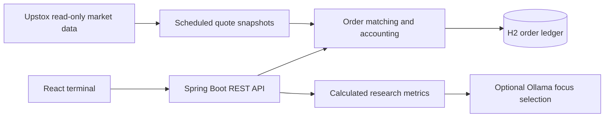

# Tape — Indian equities paper trading

Tape is a local React trading terminal backed by Java 21, Spring Boot, and an embedded H2 database. Each data mode starts with ₹10,00,000 in virtual cash. The demo uses synthetic market data and needs no account, API token, model download, or subscription.

## Run locally

Install Java 21, Maven 3.6.3 or later, and Node.js 22. Run these commands from the project folder.

```powershell
cd frontend
npm ci
npm run build
cd ..
mvn spring-boot:run
```

Open [the terminal](http://127.0.0.1:8080). Spring Boot serves the built frontend. For frontend development, leave Spring Boot running and use `npm run dev` inside `frontend`. Vite proxies the API to port 8080.

## Live NSE and BSE data

Generate a free read-only [Upstox Analytics Token](https://upstox.com/developer/api-documentation/analytics-token/) in your Upstox Developer Apps account. Set it in your local environment as `UPSTOX_ANALYTICS_TOKEN` before starting Spring Boot. Restart the backend and select **Live data**. Keep the token out of Git, browser code, and screenshots.

Tape requests one batched [quote snapshot](https://upstox.com/developer/api-documentation/get-full-market-quote-v3/) every five seconds and uses the [historical candle API](https://upstox.com/developer/api-documentation/v3/get-historical-candle-data/) for charts and stock research. A curated list covers NSE stocks and selected BSE listings. During regular weekday trading hours in India, an eligible quote must be from a trade in the last 60 seconds and the feed must be connected. Holidays and special sessions rely on the quote guard and regular-hours rule. The last known prices can still be viewed when the feed stops. Live and demo orders and balances use separate ledgers.

## Research and local AI

**Analyze a stock** computes 20-session return, daily realized volatility, and maximum drawdown from daily closes. **Analyze portfolio** reports position and sector concentration, cash allocation, and return since inception. Portfolio analysis in live mode requires fresh marks on every position.

The default report is calculated by Java. To enable optional AI prioritization, install and run [Ollama](https://docs.ollama.com/), pull a local model such as `llama3.2:1b`, set `OLLAMA_MODEL=llama3.2:1b` in the backend environment, and restart. The backend sends the calculated metrics to localhost and accepts exactly one known observation ID. The browser displays only predefined labels, values, and explanations. This keeps recommendations, forecasts, and invented numbers out of the output. Failed or unavailable model calls fall back to the calculated report. Model inference runs on your machine with no paid API.

## Order behavior

- Market orders fill at the latest eligible quote. Limit and stop-market orders are checked about every two seconds while the server runs. Open orders remain in the database until filled, cancelled, or rejected on a funding shortfall.
- A pending buy reserves virtual cash at its trigger price plus fees. A pending sell reserves shares. A stop buy can be rejected if the gap through its trigger costs more than available cash after reservations.
- Cash equity trades use whole shares, long positions, and a simulated fee of 0.05% per fill rounded up to the next paisa. Average cost includes buy fees. Realized P&L deducts sell fees.
- The simulator uses sampled last-trade prices and assumes a full fill. It models neither order-book depth nor partial fills. Quote gaps while the backend is offline are not replayed.



Run `mvn test` to verify reservations, cancellations, idempotency, fill accounting, feed isolation and stock analysis. The app binds to loopback and is designed for a single local workspace. Public multi-user hosting would require authentication, durable per-user accounts, and verification of market-data redistribution rights. The checked-in code makes no broker order calls.

**Resume bullet:** Built an Indian-equity paper trading terminal with React and Spring Boot, a persistent virtual order ledger, live quote integration, and local AI prioritization of verified stock and portfolio metrics.
