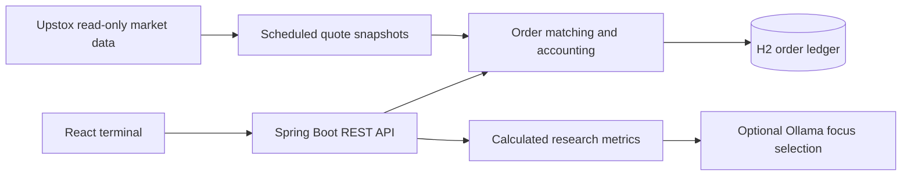

# Tape — Indian equities paper trading

Tape is a local React trading terminal backed by Java 21, Spring Boot, and an embedded H2 database. Each data mode starts with ₹10,00,000 in virtual cash. The demo uses synthetic market data and needs no account, API token, model download, or subscription.

## Run locally

Use Java 21 (Temurin in CI) and Node.js 22.23.1 with the bundled npm. The Maven Wrapper pins Maven 3.10.0 and downloads it on first use. On Linux or macOS, install unzip for the checksum-pinned wrapper distribution. Run these commands from the project folder.

```powershell
cd frontend
npm ci
npm run build
cd ..
./mvnw.cmd spring-boot:run
```

Use `./mvnw` instead of `./mvnw.cmd` on Linux or macOS. Open [the terminal](http://127.0.0.1:8080). Spring Boot serves the built frontend. For frontend development, leave Spring Boot running and use `npm run dev` inside `frontend`. Vite proxies the API to port 8080.

## Authenticated paper accounts

The optional PostgreSQL workspace supports registration, sign-in, sign-out, and separate funded virtual accounts per user. Enable account-scoped synthetic Demo trading with the [trading setup](docs/trading.md#enable-a-local-demo-workspace). Live-data execution remains disabled. The default loopback H2 terminal retains the existing simulator, charts, research and order flows. See the [authentication guide](docs/authentication.md) for profile setup and API contracts.

## Read-only NSE and BSE data

The authenticated **Market data** workspace is disconnected by default. Once your permitted use is documented, follow the [market-data setup](docs/market-data.md) to configure the local owner and server-side Upstox Analytics Token. The old H2 live ledger remains available for review and cancellation.

## Futures and options foundation

Stage 2G adds a separate PostgreSQL derivatives book with versioned contracts, premiums, margin collateral, futures variation, and expiry events. The internal foundation is exercised against PostgreSQL 17. The terminal continues to offer synthetic equity execution. See the [derivatives architecture and test setup](docs/derivatives.md).

Stage 2H adds an opt-in options workspace with virtual market and limit orders on the synthetic Practice Index. See the [options setup, accounting rules and API](docs/options-practice.md).

Stage 2I adds opt-in cash-settled Practice Index futures. See the [futures setup, daily marking and margin policy](docs/futures-practice.md).

## Research and local AI

**Analyze a stock** computes 20-session return, daily realized volatility, and maximum drawdown from daily synthetic closes. **Analyze portfolio** reports position and sector concentration, cash allocation, and return since inception in the legacy Demo terminal.

The default report is calculated by Java. To enable optional AI prioritization, install and run [Ollama](https://docs.ollama.com/), pull a local model such as `llama3.2:1b`, set `OLLAMA_MODEL=llama3.2:1b` in the backend environment, and restart. The backend sends the calculated metrics to localhost and accepts exactly one known observation ID. The browser displays only predefined labels, values, and explanations. This keeps recommendations, forecasts, and invented numbers out of the output. Failed or unavailable model calls fall back to the calculated report. Model inference runs on your machine with no paid API.

## Order behavior

- Market orders fill at the latest eligible quote. Limit and stop-market orders are checked about every two seconds while the server runs. Open orders remain in the database until filled, cancelled, or rejected on a funding shortfall.
- A pending buy reserves virtual cash at its trigger price plus fees. A pending sell reserves shares. A stop buy can be rejected if the gap through its trigger costs more than available cash after reservations.
- Cash equity trades use whole shares, long positions, and a simulated fee of 0.05% per fill rounded up to the next paisa. Average cost includes buy fees. Realized P&L deducts sell fees.
- The simulator uses sampled last-trade prices and assumes a full fill. It models neither order-book depth nor partial fills. Quote gaps while the backend is offline are not replayed.



Run `./mvnw.cmd clean verify` on Windows or `./mvnw --batch-mode clean verify` on Linux or macOS. The GitHub Actions workflow builds the locked frontend with `npm ci` and verifies the backend. The default suite uses in-memory H2. CI also runs the opt-in PostgreSQL schema suite. Both suites disable Upstox and Ollama. The characterization suite uses controlled quotes and runs matching explicitly. The legacy terminal binds to loopback and uses one shared local workspace. The PostgreSQL account workspace provides authentication and isolated balances. Shared deployment still requires operational hardening and verification of market-data rights. The checked-in code makes no broker order calls.

## Back up the local H2 database

When started from the project root with the default configuration, the database is at `data/tape.mv.db`. A datasource override or a different working directory can change that location.

1. Stop Tape gracefully and confirm no process is using the database. H2 keeps this embedded database open while Tape runs. A direct copy of a live file is unsafe. H2's online backup requires a connection through the owning process, which Tape does not expose.
2. Copy the closed file into a new private backup directory outside the Git workspace. On Windows, hold a read handle with `FileShare.Read` during the copy to prevent concurrent writers. If the handle cannot be acquired, defer the copy. Compare SHA-256 hashes of source and backup before restarting Tape.
3. Make a disposable copy of the backup and open that copy with the same H2 version using `IFEXISTS=TRUE` and `ACCESS_MODE_DATA=r`. Check that both `paper_order` and `watchlist` can be read and reconcile order counts by mode with the expected totals. Retain the original backup separately. A matching hash verifies the copy, while opening and reading the disposable copy verifies it can be restored.

See the [database guide](docs/database.md) for the Stage 2A PostgreSQL profile, migrations and tests, and [ADR 0001](docs/adr/0001-account-storage-and-ledger.md) for the multi-user design.

See the [public launch checklist](docs/public-launch.md) for the multi-instance account foundation, remaining technical requirements, and market-data licensing.

The [identity readiness guide](docs/identity-readiness.md) covers verified email, password recovery, shared-session revocation, SMTP configuration, and PostgreSQL backup and restore checks.

The [private beta runbook](docs/private-beta.md) covers closed/allowlisted registration, Brevo SMTP setup, the backup-gated V4-to-V12 upgrade, a loopback-only Compose deployment and the complete Chrome/STARTTLS test journey. See [Stage 2M validation](docs/stage-2m-validation.md) for actual migration and test results. CI runs the PostgreSQL suite and Chrome journey with provider access disabled.

For invited remote access, use the [remote beta checklist](docs/remote-beta.md): explicit 80/443 ingress configuration, release tags, secret-safe preflight, real sender setup, encrypted off-host backups, monitoring and restart/recovery. Defaults remain loopback-only; no host or public deployment is created automatically.

**Resume bullet:** Built an Indian-equity paper trading terminal with React, Spring Boot, and PostgreSQL, with an isolated virtual order ledger, a permission-gated market-data adapter tested against fixtures, and local AI summaries of computed research metrics.
